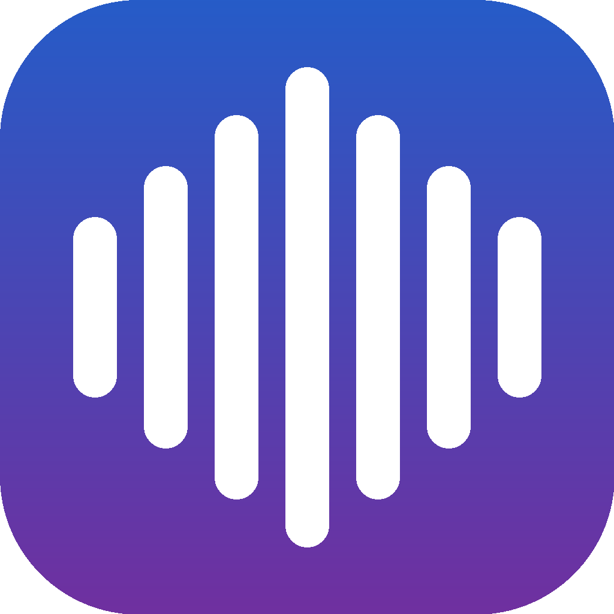

# EdgeSpeak

A native macOS app that reads PDFs and text aloud while it highlights what it is
reading. Synthesis streams in slices, so audio plays as each slice is
synthesized instead of waiting for the whole document, and the sentence being
spoken is highlighted in the PDF. With an online voice the word being read is
highlighted too. The first slice is deliberately short (~450 characters), so
speech begins quickly. Native SwiftUI, macOS 14+.


[](https://buymeacoffee.com/gilsonolegario)

## Download

Grab the latest pre-built app from the [Releases page](https://github.com/gilsonolegario/edge-speak) — or build it locally:

```bash
./build-app.sh    # macOS 14+ → EdgeSpeak.app (~130 MB, measured 2026-10-14)
```

or run straight from the source tree (development mode; the bundled Python base
and the wheels are packed only by `build-app.sh`):

```bash
swift run EdgeSpeak
```

`build-app.sh` needs [`uv`](https://github.com/astral-sh/uv) (`brew install uv`)
and a Python 3.13 managed by uv (`uv python install 3.13`). It downloads the
Python base, the wheels (edge-tts, PyMuPDF, onnxruntime, pathvalidate) and the
Piper wheel **at build time** and packs everything into the `.app`. The script
aborts if EdgeSpeak is running — repacking over an open bundle corrupts it.
Piper voices are **not** packed: each downloads once on first use (~63 MB). See
[First launch](#first-launch) for how to open the pre-built download the first
time.

## First launch

The release download is **not notarized** — notarization requires a paid Apple
Developer account; the build is ad-hoc signed — so macOS blocks the first launch.

On macOS 15 (Sequoia) and later the old right-click → Open bypass is **gone**; use
this flow instead:

1. Double-click `EdgeSpeak.app` → the dialog says it can't be opened → click **Done**.
2. Open **System Settings → Privacy & Security → Security** (scroll to the bottom).
3. Under "Allow applications from", find *"EdgeSpeak was blocked to protect your Mac"* → click **Open Anyway** → confirm with your password.
4. Launch EdgeSpeak normally from now on.

On macOS 14 (Sonoma) you can still right-click the app → **Open** → **Open**.

> **Tip:** `Open Anyway` only appears for ~1 hour after the blocked launch. If you don't see it, double-click the app once more and go straight back to System Settings.
>
> **Troubleshooting:** if macOS claims the app is "damaged", remove the quarantine attribute once:
>
> ```bash
> xattr -dr com.apple.quarantine /Applications/EdgeSpeak.app
> ```

**Prefer to skip all of this?** Build locally — a `swift build` output never receives the quarantine attribute, so Gatekeeper stays out of the way (requires the Xcode Command Line Tools; the build script fetches the Python runtime and the wheels).

## Major features

- **Streaming playback** — audio plays as each slice is synthesized; the first slice is short on purpose so speech starts quickly.
- **Sentence highlighting in the PDF** — one highlight annotation per line box of the sentence, never the whole paragraph.
- **Word highlighting (karaoke)** — the online voice returns per-word timings, so the word being read is highlighted too.
- **Click to read from a sentence** — click any sentence in the PDF or the text panel to start or jump the reading right there; with no audio yet, synthesis starts at the clicked sentence instead of the beginning.
- **Footnotes** — a glued marker ("argument.7") is announced ("footnote 7") and the note body is read right after it; a horizontal ruler (the note zone) also marks the markers when the PDF omits the superscript bit; the *Read footnotes* option turns the whole thing off.
- **Two voices, one transport** — online (Microsoft neural, needs a network) or offline (Piper, local, no word timings).
- **Logic formulas spoken** — `∀`, `∃`, `⊢`, `∈`, `ℕ` … are expanded into words in the voice's language, with the pauses a classroom reading uses.
- **Filtered or full text** — strip repeated headers and footers, hyphenation and the bibliography, or read the document verbatim.
- **Audio export** — write the reading out as WAV (offline voice) or MP3 (online voice).
- **Passage summary (on-device)** — ⌘⇧M summarizes the passage with Apple Intelligence (macOS 26+) and shows the text in a sheet you can copy; on Macs without the model the app says so and the reading is unaffected.
- **Per-document resume** — the reading position is remembered per document and voice (and the *Resume from last position* switch in Settings respects your choice).
- **Sleep timer** — stop the reading after 5, 15, 30 or 60 minutes (Options menu).
- **Copyable diagnostics** — a version, environment, cache and status report in Settings → Advanced, copied to the clipboard on demand.
- **No daemons** — nothing runs in the background; the only network traffic is voice synthesis and the one-time voice download, and nothing is installed outside your home folder.

## Voices

Two engines in the same transport; switch from the toolbar selector or Settings → Reading.

- **Online (edge-tts)** — Microsoft neural voices, needs a network. Returns per-word timings, which is why word-level highlighting exists only here. Failures — including a 403 from the service — break the retry loop and surface as readable messages instead of retries in vain.
- **Offline (Piper)** — local synthesis, one sentence at a time, no word timings, so sentence highlighting only. Five voices in the selector: Faber, Edresson, Cadu and Jeff (Portuguese) and Lessac (English). None ships in the app — each downloads once on first use (~63 MB) to `~/Library/Application Support/EdgeSpeak/voices`; the datasets are CC0. Credit and license (GPL-3.0) in [CREDITS.md](CREDITS.md).

## Reading and highlighting

- **Blue per sentence**: one highlight annotation per line box of the sentence — never the paragraph. Boxes come from the extractor in reading order, falling back to the paragraph when the sentence does not match. The word highlight is drawn on the page that owns the word's box, which is not always the page where its sentence starts.
- **Yellow per word** (online only): a global alignment between the spoken sequence and the PDF sequence. Where the PDF has a symbol and the voice has a phrase ("∃uT (u,o)" → "there exists u, such that, T of u"), the expansion word gets **no box** instead of stealing a later prose box. In the text panel the spoken word matches by whole word only, so expansions of years and citations ("Carnap 1950" → "Carnap mil novecentos e cinquenta") miss cleanly instead of dragging the highlight forward. Repeated words resolve by context (±3), not by the first occurrence.
- **Scrolling**: automatic follow can be turned off. A manual scroll only holds the follow for the moment — any highlight advance releases it and the view resumes following, and the follow setting keeps its value. The **Go to the passage** button returns to the reading point. Clicking a sentence **plays from it**: with no audio yet, synthesis starts at the clicked sentence; with audio, the jump goes straight to the slice, without waiting for timings not yet measured.
- **Footnotes** (on by default): the glued marker ("argument.7") is announced ("footnote 7") and the body is read right after — the importer moves it to after the marker's sentence without changing the other sentences' indices. When the PDF omits the superscript bit, a horizontal ruler (the note zone) also marks the markers. Honest limit: in a PDF whose text layer does not carry the note body, only the marker is announced.

## Logic formulas

The spoken filter (`ReadAloudFilter`) expands the notation in the voice's language, with the pauses a classroom reading uses. Coverage (EN/PT):

- Quantifiers ∀ ∃ ∃! with a variable, modals □ ◇, turnstiles ⊢ ⊨ and negations ⊬ ⊭, ASCII `|-` `|=` `->` `=>` `<->`.
- Sets ∈ ∉ ⊆ ∪ ∩ ∖ ∅ ℘, set-builder `{x | φ}` / `{x : φ}`, horseshoe ⊃ by context (superset between sets, conditional between formulas).
- Greek by name, blackboard-bold ℕ ℤ ℚ ℝ ℂ, iota ℩, Quine corners, primes p′ ("p prime"), §2 ("section 2"), functors ("T of u, o"), R_H.
- Comparisons `<=` `>=` `!=` `<>` `/=`, identity, ⊥/⊤.
- **Deliberate silence**: `[]`/`<>` as a modal, `x` in "3 x 4" as "times", a lone bar outside a set-builder — verbalizing them would break ordinary prose.

Known limit: quality depends on the PDF text layer; a symbol that arrives as an image is not read.

## How to install and use the app

1. Download `EdgeSpeak-vX.Y.Z-macos-arm64.zip` from the [Releases page](https://github.com/gilsonolegario/edge-speak/releases) and unzip it.
2. Drag `EdgeSpeak.app` to your Applications folder.
3. Open it. If macOS blocks it, follow [First launch](#first-launch).
4. Click **Open** in the toolbar and pick a PDF, Markdown or text file — or drop a file onto the icon (the app registers PDF, plain-text and Markdown document types).
5. Press **Enter** to play/pause. The sentence being read is highlighted in the PDF.
6. Click any sentence in the PDF (or in the text panel) to read from there.
7. Open **Settings (⌘,)** to choose the voice, rate, follow mode and interface language.

### Shortcuts

| Key | Action |
|---|---|
| Enter | Play / pause |
| Space | Play / pause (when no control has keyboard focus; a focused control — button, field, editor or the PDF — gets the key) |
| ⌥← / ⌥→ | Jump 15 s back / forward |
| ⌘. | Stop synthesis |
| ⌘− / ⌘+ / ⌘0 | Font size down / up / default |

## macOS compatibility

| Version | Notes |
|---|---|
| macOS 14 (Sonoma) | supported |
| macOS 15 (Sequoia) | supported |

The pre-built download is `arm64` (Apple Silicon) only.

## Settings

Three tabs:

- **Reading** — voice, rate, follow the reading, PT/EN interface language.
- **Text** — typeface, full text, read footnotes.
- **Advanced** — on-disk cache size, a clear button and a copyable diagnostic report.

Everything persists between sessions. The interface is available in Portuguese and English, switched on the fly (Portuguese by default). Honest note: the Settings window cannot see the main-window controller, so controls are not disabled during synthesis — a changed rate applies to the next synthesis anyway.

## Architecture

One SwiftPM executable target, `EdgeSpeak`, from `Sources/EdgeSpeak/`, plus a test
target `EdgeSpeakTests` from `Tests/EdgeSpeakTests/` (the suite was removed by owner
decision on 2026-10-15 and restored by the 2026-10-17 unification). Verification is
`swift build` and `swift test`, plus the live app. SwiftUI on macOS 14+, with
PDFKit and TextKit wrapped in `NSViewRepresentable`. Two synthesis engines run
as child processes: `edge-tts` online (streaming slices with per-word timings)
and Piper offline (one WAV per sentence, persistent session). `StreamingPlayer`
is the single source of truth for playback state; `SpeechController`
orchestrates the engines and mirrors the player. PDF text comes from PyMuPDF
(AGPL-3.0, via `Tools/pdf_extract.py` in a separate Python process) with a
PDFKit fallback, and the reading order is rebuilt in Swift by a recursive
XY-cut. The spoken text (`ReadAloudFilter.forSpeech`) and the displayed text
(`clean`) are separate paths that never mix. The app packs a Python 3.13 base
and wheels, and prepares a venv on first run.

## Build

Requires macOS 14+, the Swift 6 toolchain (SwiftPM), and — for `build-app.sh`
only — `uv` with a Python 3.13.

```bash
swift build
./build-app.sh   # → EdgeSpeak.app (~130 MB) at the project root
```

The test suite runs with `swift test` — 400 tests in 52 suites as of
2026-10-19 (the suite was removed on 2026-10-15, restored by the 2026-10-17
unification and reconciled with the live tree on 2026-10-19).

`build-app.sh` downloads the Python base, the wheels and the Piper wheel **at
build time** and packs the `.app` with everything inside (details in the script
header). On first run the app prepares a Python venv in
`~/Library/Application Support/EdgeSpeak` from what ships in the bundle; cached
audio lives in `~/Library/Caches/EdgeSpeak`. Nothing is installed as a daemon
and nothing runs in the background.

## Documentation

- **Layer-by-layer contract** (files, functions and rules) — [INTERFACE.md](INTERFACE.md)
- **Third-party credits and licenses** — [CREDITS.md](CREDITS.md)

## History

**main após 0.1.2** — repetição da primeira leitura eliminada (o salto gasta a
espera do pré-buffer), destaque que acompanha desde a abertura (liberação na
sonda de duração, timer reinstalado, posicionamento imediato), amarelo na
página da própria caixa, contexto do painel religado na troca de documento e
casamento por palavra inteira em citações. Suite e diretório de pesquisa
removidos por decisão do dono; a suite foi restaurada na unificação de
2026-10-17.

**0.1.2** — Footnotes land right: the marker only counts when its digits are in its own sentence (no more early body plus a repeated announcement), citations unwrap with their content kept behind a toggle, and "et al." survives the cleanup. Playback pre-buffers three slices before the first sound, then runs without stalling.

**0.1.1** — Robustness and comfort release. The reading highlight now crosses page turns without losing the follow (a manual scroll holds it only for the moment, then the highlight re-takes it); footnote markers resolve end to end and a formula line no longer swallows prose that merely mentions a symbol; hyphen joins prefer in-document evidence before the system dictionary. Note markers are also caught by overline geometry when the PDF omits the superscript bit. The progress bar reads the real playback position instead of a 10 Hz stale snapshot. New: a sleep timer (Options menu) and a copyable diagnostic report (Settings → Advanced).

**0.1.0** — First release: streaming synthesis with sentence and word highlighting, click-to-read from a sentence, footnote markers announced with the body linked right after, logic-formula expansion, PT/EN interface, three-tab Settings, audio export and per-document resume.

## Known limits

- Footnote bodies in PDFs whose text layer does not carry them: the marker is announced, the body does not exist to be read.
- A logic symbol that arrives as an image is not read; formula quality depends on the PDF text layer.
- The online voice depends on the Microsoft endpoint; an outage shows up as a message, not a freeze.
- Offline voices need the network once (the ~63 MB download); after that, reading is fully local.
- Quitting before the synthesis reaches 100% leaves no cached audio: reopening synthesizes again from the start.

## License

EdgeSpeak is released under the [GPL-3.0 License](LICENSE). Piper (GPL-3.0) and PyMuPDF (AGPL-3.0) run from wheels packed in the app; the Piper voice datasets are CC0 — see [CREDITS.md](CREDITS.md).

---

Built with [opencode](https://opencode.ai) — the open-source AI coding agent.
